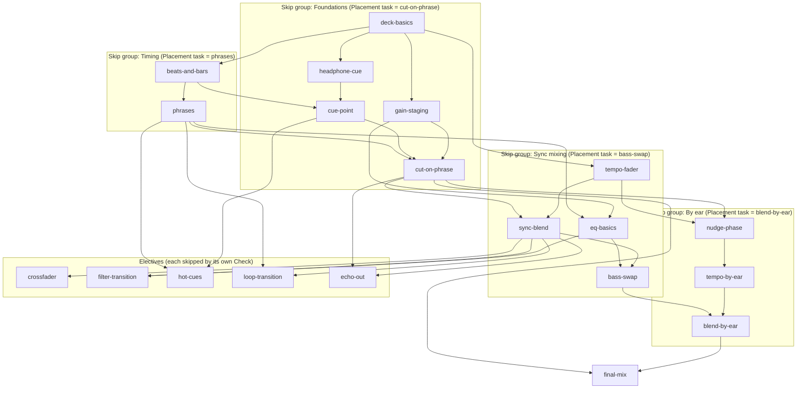

# Lesson catalogue (v1)

Status: **proposal**. Nothing here is decided until the owner answers the questions in §4.
Terms follow `GLOSSARY.md` (Learner, Lesson, Lesson catalogue, Curriculum, Placement, Check,
Skill profile, Coach). DJ terms follow Pioneer DJ / AlphaTheta wording, as listed in
`docs/research/dj-terminology-and-curriculum.md` (branch `research/dj-terminology-and-curriculum`).

Inputs:
- Skill order, the LCME syllabus and the 15 beginner mistakes: `research/dj-terminology-and-curriculum`.
- Final controller layout (DDJ-FLX4): `research/entry-level-controllers`.
- Split cue (cue mono left, master mono right, plus a MIXING knob) for v1: `research/browser-headphone-cueing`.
- What can be measured: `research/browser-audio-analysis`. Phase error comes from each deck's playhead
  model and the beat grid, not from recorded audio, so grading to about 10 ms is realistic. Phrase
  boundaries are hints derived from the downbeat grid, so Lesson track sets need hand-checked grids
  and phrase markers.

Settled (from the brief): each Lesson teaches 1–2 concepts, unlocks the controls they need, and ends
in a deterministic Check. Sync is allowed as a teaching aid; only `final-mix` forbids it. v1 is done
when the Learner passes `final-mix`.

## LCME Debut (≈ grade 1) criteria used below

| Code | Criterion (LCME DJ syllabus 2020, Debut) |
|---|---|
| **L1** | Listening: clap every beat, the first beat of every bar, the first beat of every 2 bars |
| **L2** | Equipment knowledge: what each control does, signal flow |
| **L3** | Set cue points by ear |
| **L4** | Phrasing: trigger track 2 "on beat 1 of the first new phrase" |
| **L5** | Beat-syncing: keep tracks in sync by ear, sync banned, quantize off, display covered, tempos within ±2% |
| **L6** | Balance: "clarity and balance in all frequency ranges", no clipping |
| **L7** | Prepared mix: ≥3 tracks, one genre, at least one blend and one cut |

"(beyond)" marks a Lesson that LCME places at Breakthrough or later. We keep it because it is on
the FLX4 layout and in v1 scope.

## 1. Lessons in order

Sync column: **n/a** = tracks share one BPM, so there is nothing to sync; **on** = the Lesson uses
sync; **avail** = unlocked, the Learner may use it; **off** = locked off.

Thresholds are starting values to tune after the owner plays through (Q9).

| # | id | Title | Concepts | Controls unlocked | Prereqs | Sync | Check (what is measured, rough threshold) | LCME |
|---|---|---|---|---|---|---|---|---|
| 1 | `deck-basics` | Play a track out loud | Deck; channel fader | Load, Play/Pause, channel fader (deck A), master level | — | n/a | Fade a track in from silence and back out with the channel fader: master audible within 4 bars of Play, fader fully down at the end, no master clipping | L2 |
| 2 | `beats-and-bars` | Find the beat and the one | Beat; bar / downbeat | Tap button (Lesson-only input, not a controller part) | `deck-basics` | n/a | Tap every beat for 8 bars, then only downbeats for 8 bars: ≥90% of taps within ±40 ms of the grid, no taps on the wrong beat of the bar | L1 |
| 3 | `phrases` | Count phrases | Phrase; track structure (intro, breakdown, drop, outro) | — | `beats-and-bars` | n/a | Tap the first beat of each phrase across 64 bars: ≥6 of 8 phrase starts hit within ±1 beat, no more than 1 false tap; then name the breakdown and the drop correctly | L1, L4 |
| 4 | `gain-staging` | Set the level | Trim; channel level meter, clipping | Trim, channel level meter (A and B), master level meter, Load B, channel fader B | `deck-basics` | n/a | Set trim on two tracks so both channel meters peak in the target zone without CLIP for 8 bars; short-term loudness of A and B within 1.5 dB | L6 |
| 5 | `headphone-cue` | Listen before they hear it | Headphone cue; cue/master mix (split cue) | Headphone CUE buttons, headphone level, MIXING knob | `deck-basics` | n/a | With A on master, play B with channel fader B down and cued in headphones; tap B's beat for 8 bars: ≥85% of taps within ±50 ms of **B's** grid; B never reaches master | L2, L5 |
| 6 | `cue-point` | Set a cue point by ear | Cue point | Deck CUE button, jog wheel (search while paused only) | `beats-and-bars`, `headphone-cue` | n/a | On 3 tracks, quantize off, waveform zoom hidden, set the cue point on a downbeat by ear while previewing in headphones: each within ±20 ms of the downbeat | L3 |
| 7 | `cut-on-phrase` | Your first transition: the cut | Cut (drop mix); phrasing | — (combines 1–6) | `phrases`, `gain-staging`, `cue-point` | n/a | Same-BPM tracks, beats already in phase: start B from its cue point at A's next phrase start and cut the channel faders: Play within ±40 ms of the phrase downbeat, B cued before its fader rises, master loudness jump ≤2 dB, no dead air | L4, L7 |
| 8 | `tempo-fader` | Speed and pitch | Tempo fader and BPM; Master Tempo | Tempo fader, tempo range (Shift + button), Master Tempo, BPM display | `deck-basics` | n/a | Display visible: set B to 3 target BPMs within ±0.05 BPM each; then say whether Master Tempo was on or off in two listening clips (2 of 2 correct) | L2, L5 |
| 9 | `sync-blend` | Blend with sync | Beat Sync; blend over a phrase | SYNC button | `cut-on-phrase`, `tempo-fader` | on | Tempos ≤3% apart, sync on: start B on A's phrase start and cross the channel faders over 8–16 bars: start within ±1 beat of the phrase start, master loudness stays within ±3 dB, trim untouched during the blend, no clipping | L4, L7 |
| 10 | `crossfader` | The crossfader | Crossfader | Crossfader | `sync-blend` | avail | One 16-bar blend and one cut, using only the crossfader with both channel faders up: same limits as `sync-blend` and `cut-on-phrase` | L2, L7 |
| 11 | `eq-basics` | Shape the sound with EQ | EQ (HI/MID/LOW); cutting, not boosting | HI, MID, LOW per channel | `gain-staging`, `phrases` | n/a | Cut LOW fully for one phrase and bring it back on the next phrase start: return within ±1 beat; no band above +3 dB for more than 1 bar; all EQs within ±1 dB of centre at the end | L6 |
| 12 | `bass-swap` | Swap the bass | EQ mixing; bass swap | — | `eq-basics`, `sync-blend` | on | Sync blend with B's LOW cut, then swap the lows at a phrase start: both LOW EQs above −6 dB at the same time for ≤1 beat in total, swap within ±1 beat of a phrase start, no clipping | L4, L6 |
| 13 | `filter-transition` | The filter | Filter (CFX knob: HPF/LPF); filter transition | CFX knob per channel | `eq-basics`, `sync-blend` | avail | High-pass A out over 8–16 bars while B comes in: filter reaches ≥70% HPF before A's fader closes; A's CFX back at centre within 1 bar of A going silent | L6 (beyond: Breakthrough "filters") |
| 14 | `nudge-phase` | Nudge it back in line | Pitch bend with the jog wheel; phase | Jog wheel pitch bend (while playing), phase meter | `cut-on-phrase`, `tempo-fader` | off | Same tempo, B starts up to ¼ beat out of phase: bring the phase error under 15 ms within 4 bars and hold it there for 8 bars; ≤1 CUE press on B (re-cueing is counted) | L5 |
| 15 | `tempo-by-ear` | Match tempo by ear | Hearing which deck is faster; correcting with the tempo fader | — (BPM display and phase meter hidden) | `nudge-phase` | off | Tracks 0.5–2% apart, display covered: within 32 bars get tempos within ±0.1 BPM and phase under 20 ms, held for 8 bars; tempo fader reversals reported (overcorrecting) | L5 (beyond: Breakthrough asks this) |
| 16 | `blend-by-ear` | A full blend by ear | Holding a long blend; recovering drift | — | `tempo-by-ear`, `bass-swap` | off | Display covered, ≤2% apart: 16-bar blend with a bass swap, start on a phrase start: phase error <25 ms for ≥85% of the time both are audible, never >60 ms for more than 1 bar; bass-clash and balance limits from `bass-swap` | L4, L5, L6 |
| 17 | `hot-cues` | Hot cues | Hot cue (pads in Hot Cue mode) | 8 pads per deck, HOT CUE pad mode | `cue-point`, `phrases` | avail | Set hot cues on 3 phrase starts, then trigger each on A's phrase start: within ±40 ms; quantize off | L3 (beyond: Breakthrough "hot cue jump") |
| 18 | `loop-transition` | Loop to buy time | Loop (4-beat auto loop, loop in/out); loop transition | LOOP IN, LOOP OUT, 4 BEAT/EXIT | `sync-blend`, `phrases` | avail | Loop A's last 4 bars, bring B in on a phrase start, exit the loop on a downbeat: loop length exactly 4 or 8 bars, start and exit within ±1 beat of a downbeat, no audible double-trigger | (beyond: Breakthrough "loop") |
| 19 | `echo-out` | The echo out | Beat FX ECHO; echo out | BEAT FX select (ECHO only), channel select, beat ◀/▶, depth, ON/OFF | `cut-on-phrase`, `sync-blend` | avail | Engage ECHO on A, cut A's fader on a downbeat, B starts on the phrase start: cut within ±1 beat; Beat FX off within 2 bars after the repeats die out; no dead air | L7 (beyond: Artist "echo") |
| 20 | `final-mix` | Your first set | Prepared mix; choosing tracks that mix well | — (all unlocked; sync and quantize locked off; display covered) | `blend-by-ear`, `cut-on-phrase` | **off** | ≥3 tracks of one genre, tempos within ±2%, ≥1 blend and ≥1 cut, all by ear: every transition starts within ±1 beat of a phrase start; during blends phase error <25 ms for ≥85% of the time, never >60 ms for more than 1 bar; no clipping; no dead air; channel loudness within 2 dB at each handover | L1–L7 |

Control growth: after Lesson 20 the virtual controller shows every FLX4 control in v1 scope (Deck A,
mixer, Deck B as in `entry-level-controllers` §3). Out of v1 and never unlocked: pad modes other
than Hot Cue, Beat FX other than ECHO, Smart CFX / Smart Fader, mic, stems, Vinyl-mode scratching.
The filter is the CFX knob.

## 2. Prerequisite graph

Each box is a **skip group**: a set of Lessons that Placement can pass together with one hands-on
task, which is the Check of the group's last Lesson. Placement never skips `final-mix`.

Notes:
- Passing a group's task marks every Lesson in the group as demonstrated in the Skill profile. A
  Learner who fails it takes Placement tasks for the earlier Lessons in that group, so Placement
  narrows down instead of restarting.
- `tempo-fader` sits in the Sync-mixing group but is also a prerequisite of the By-ear group; a
  Learner who passes `blend-by-ear` in Placement has shown it too.
- The critical path to `final-mix` is Lessons 1–9, 11, 12 and 14–16, then 20 (15 Lessons). Electives are
  off it (Q11).

## 3. Where the 15 beginner mistakes get caught

"Standing criterion" (see §5) means: once the Lesson that teaches it has been passed, every later
Check measures it too.

| # | Mistake | Taught and first caught in | Standing afterwards? |
|---|---|---|---|
| 1 | Clipping / playing in the red | `gain-staging` | Yes, fails the Check (Q10) |
| 2 | Unbalanced levels between tracks | `gain-staging`; loudness jump in `cut-on-phrase` | Yes, from `cut-on-phrase` |
| 3 | Using trim as a volume control | `gain-staging` (explained); trim movement during a transition is measured in `sync-blend` | Yes, warning |
| 4 | Two basslines at once (bass clash) | `bass-swap` | Yes, from `blend-by-ear` |
| 5 | Boosting EQ instead of cutting | `eq-basics` | Yes, warning |
| 6 | Drift / trainwreck | `nudge-phase` (short), `blend-by-ear` (long) | Yes, in `final-mix` |
| 7 | Re-cueing instead of nudging | `nudge-phase` (CUE presses counted) | Yes, warning |
| 8 | Overcorrecting tempo | `tempo-by-ear` (tempo fader reversals, size of pitch bends) | Reported to the Coach, not pass/fail |
| 9 | Mixing off-phrase | `cut-on-phrase`, then `sync-blend` (start) and `bass-swap` (swap point) | Yes, fails the Check |
| 10 | Not cueing in headphones first | `headphone-cue`; enforced from `cut-on-phrase` (fader raised on a deck never cued) | Yes, warning |
| 11 | Breaking sync with a pitch bend | `sync-blend` shows the SYNC light going off; `nudge-phase` explains why | Warning while sync is on |
| 12 | Leaving the filter or EQ off centre | `eq-basics` (EQs reset), `filter-transition` (CFX reset), `echo-out` (Beat FX off) | Yes, warning |
| 13 | Dead air | `cut-on-phrase` | Yes, fails the Check (Q10) |
| 14 | Key clash | Not caught in v1: harmonic mixing is out of scope. Lesson track sets are chosen key-compatible; `final-mix` warns only | — |
| 15 | Overusing one technique | `final-mix` requires a blend and a cut; the Coach reads technique counts from the Skill profile | Coach feedback only |

## 4. Open questions for the owner

Each question is worded so that "yes" accepts the recommendation.

1. **Channel faders before the crossfader.** Teach the first blend with channel faders (`sync-blend`)
   and the crossfader as a separate, optional Lesson afterwards? *Recommended: yes.* Channel faders
   are what LCME and DDJT use for blends, and they make the per-channel signal path visible.
2. **EQ mixing before beatmatching by ear.** Teach `eq-basics` and `bass-swap` with sync on, before
   the By-ear group? *Recommended: yes.* The Learner hears clean, musical blends early, and
   `blend-by-ear` then adds only one new difficulty.
3. **Cut before blend.** Make the cut (drop mix) the first complete transition, before any tempo
   or sync work? *Recommended: yes* (Point Blank and LCME both do this; it needs only cueing and
   phrase counting).
4. **Tempo fader allowed in `final-mix`.** In `final-mix`, may the Learner use the tempo fader to
   match tempo by ear (display covered), not only the jog wheel? LCME Debut asks only for jog-wheel
   correction and does not test tempo matching by ear. *Recommended: yes.* With tracks up to 2%
   apart, riding the jog wheel alone is not a useful habit.
5. **Visual aids switched off step by step.** Show the phase meter and BPM in `nudge-phase`, hide
   both from `tempo-by-ear` on, and keep them hidden in `final-mix` with no override? *Recommended: yes.*
6. **Attempts before a Review.** After 3 failed attempts in a row on the same Check criterion, the
   Coach suggests a Review of the Lesson that introduced it, and the Learner may decline?
   *Recommended: yes.* The Coach suggests and never forces, and a declined Review is recorded in
   the Skill profile.
7. **Genre order by tempo and groove.** Use house (120–126 BPM, steady four-on-the-floor) for all
   Lessons up to `blend-by-ear`, add techno (125–135) in the By-ear group, use UK garage (130–134,
   swung 2-step) only for practice after `blend-by-ear`, and leave dubstep (140, half-time) out of
   every v1 Check? *Recommended: yes.* A swung or half-time kick pattern makes phase errors harder to
   hear, and `final-mix` must be "one genre" anyway.
8. **Only DJ-friendly versions in Lesson track sets.** Use extended mixes with clean 16–32-bar intros
   and outros; EDM remixes of pop or library tracks appear only from `blend-by-ear` on, and radio
   edits never? *Recommended: yes.* Vocals from bar 1 make a beginner's blend clash.
9. **Thresholds as starting values.** Accept the thresholds in §1 (taps ±40 ms, phase <25 ms for 85%
   of a blend, bass clash ≤1 beat, levels within 1.5–2 dB) as starting values, to be tuned once
   after the owner plays through? *Recommended: yes.*
10. **Which standing criteria fail a Check.** Clipping, dead air and off-phrase starts fail any
    Check after the Lesson that taught them; the other mistakes in §3 only produce warnings until
    `final-mix`? *Recommended: yes.*
11. **Electives off the critical path.** `crossfader`, `filter-transition`, `hot-cues`,
    `loop-transition` and `echo-out` are in the Lesson catalogue but not required for `final-mix`,
    and the Coach chooses where they go in each Curriculum? *Recommended: yes.* None of them is an
    LCME Debut requirement.
12. **Master Tempo on by default.** Turn Master Tempo on by default from `tempo-fader` on, as in the
    LCME exam setup? *Recommended: yes.*
13. **Placement by skip group.** Placement gives one hands-on task per skip group (§2), starting
    with the hardest, and narrows down on failure? *Recommended: yes.*
14. **Headphones from `headphone-cue` on.** Lessons 1–4 work on laptop speakers; from
    `headphone-cue` on, the Learner must confirm headphones are plugged in and pass a left/right
    test (to catch OS mono settings)? *Recommended: yes.*
15. **Own tracks in `final-mix`.** Lessons use a curated track set with hand-checked beat grids and
    phrase markers; `final-mix` uses the Learner's own local files (analysed in the browser, Lesson
    rules check the ±2% and one-genre limits)? *Recommended: yes.* "Real tracks" means tracks the
    Learner chose, and the curated set keeps earlier Checks fair.

## 5. Proposed glossary additions

Project terms only; DJ terms are not listed. `GLOSSARY.md` is unchanged until these are accepted.

**Standing criterion**:
A Check criterion that, once its Lesson is passed, is measured in every later Check (e.g. no clipping).
_Avoid_: Global rule, guard

**Skip group**:
A set of Lessons that Placement can mark as demonstrated with one hands-on task.
_Avoid_: Tier, block, chapter

**Review**:
A repeat of an earlier Lesson that the Coach suggests after repeated failures on one Check criterion.
_Avoid_: Remedial lesson, retry

**Lesson track set**:
The fixed, hand-checked tracks (beat grid, downbeats, phrase markers) that a Lesson's Check is run on.
_Avoid_: Playlist, sample pack

## Decisions (owner, 2026-10-16)

The 15 open questions above are all resolved as recommended. Q7 (dubstep stays out of graded Checks) was the owner's deferral to the recommendation; revisit it once the Learner can judge.

Additions from `/teach` (see GLOSSARY.md):
- **Passed vs. retained.** Passing a Check unlocks dependent Lessons straight away, so progress is never time-gated. A skill is *retained* only after a cold re-pass at least a day later. The course is done when every skill on the final-mix route is retained.
- **Warm-ups** start each session with skills due for a re-pass, on expanding intervals of roughly 1, 3, 7 and 21 days. **Bonus exercises** (interleaved drills, extra practice on weak criteria) fill the gaps and are always optional.
- **Interleaved practice sets** follow each skip group.
- **Reference cards** unlock as Lessons are passed. Each Lesson links one primary source.
- Placement opens by asking for the Learner's **Mission**: a goal, not a self-rating.
- After `final-mix`, the app links to DJ communities. Sharing a recording waits on set recording, which is out of scope.

### Final project (owner, 2026-10-16)

The owner's Mission is to post their own mixes and edits (DJ remixes, not produced remixes) to SoundCloud. So `final-mix` becomes the **final project**: the app records the Learner's mix from the master bus to an audio file they can download. Set recording is in v1 scope **for the final project only**. A general set-recording feature stays out. Uploading to SoundCloud is done by hand, and licensing is handled outside this map. Produced (DAW) remixes are a possible future effort.

### Genre focus (revised 2026-10-17)

An earlier revision (Q7b) leaned toward bass music based on about 45 SoundCloud flips the owner shared. The owner then said Spotify, not SoundCloud, is the source of truth for their taste. Their Spotify listening (about 2,190 h, 2014–2023) is indie/alt 41%, pop 18%, rock/metal 9%, house 3.2% and bass music 1.6%.

- **The course centres on house (120–126 BPM)** for every graded Lesson up to and including `final-mix`. It is closest in tempo and feel to the owner's indie and pop listening, their biggest club genre, and the easiest phrasing to learn on.
- **Remix targets** for the remix finder and Lesson track sets are house, indie-dance and nu-disco remixes of indie, pop and rock songs.
- **Bass music** (the owner's SoundCloud flips plus composer tracks) is practice material and an optional second genre after `blend-by-ear`. The final project defaults to house; the Learner may choose bass music instead.
- The `loop-transition` and `hot-cues` electives are placed early only if the Learner chooses bass music.
