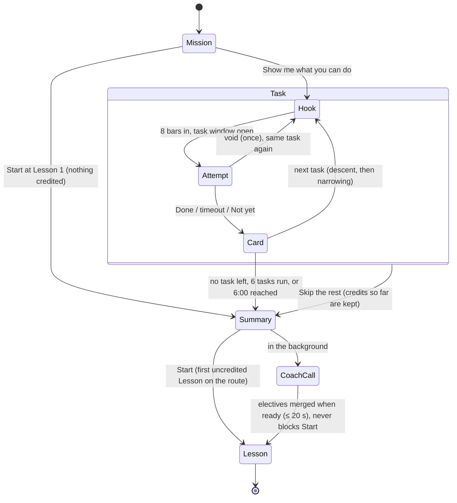

# Placement design (v1)

Status: **draft** (ISS-64). Terms follow `GLOSSARY.md`. Skip groups and the prerequisite graph
follow `docs/lesson-catalogue.md` §2 (Q13: one task per skip group, hardest first, narrowing on
failure). Criteria, tolerances, short forms, `CheckResult` and `SkillProfile` follow
`docs/check-design.md`, including its Decisions and "Input leeway". The Coach request follows
`docs/coach-design.md` §2.2 and §3.

Design limits from the owner: controller-first; one caption line, not prose; no dead waiting; every
attempt under a minute; no guided overlay; Placement **≤ 6 minutes** and skippable entirely.

## 1. Flow at a glance

1. **Mission** (≈ 20 s): one free-text line, then "Show me what you can do" or "Start at Lesson 1".
2. **Descent**: the four skip-group tasks, hardest first. The first pass ends the descent.
3. **Narrowing**: one smaller task for each failed group above the first pass (§3).
4. **Summary** (≈ 5 s): what was credited and where the Learner starts. Start is live at once.



## 2. Mission screen

- One text input, ≤ 280 characters, placeholder "e.g. post my own mixes to SoundCloud". The label
  carries an asterisk with the footnote from coach-design K2, verbatim:
  "\* Sent to Anthropic's API so the Coach can tailor your optional Lessons. Nothing else you type,
  and no audio, leaves this device."
- An empty Mission is allowed (the Coach handles it, coach-design eval C4).
- Two actions, each with a key: **Enter** = "Show me what you can do", **Esc** = "Start at Lesson 1".
  The Mission is kept either way.
- No self-rating question anywhere (Glossary: Placement is never self-reported).

## 3. Task order: descent and narrowing

| Skip group (hardest first) | Group task (catalogue §2) | Narrowing task | Narrowing credits on pass |
|---|---|---|---|
| By ear | `blend-by-ear` | `nudge-phase` | `nudge-phase` + its ancestors |
| Sync mixing | `bass-swap` | `sync-blend` | `tempo-fader`, `sync-blend` + ancestors |
| Foundations | `cut-on-phrase` | `cue-point` | `cue-point`, `headphone-cue`, `deck-basics`, `beats-and-bars` |
| Timing | `phrases` | `beats-and-bars` | `beats-and-bars`, `deck-basics` |

Rules (pure function `nextTask(state, catalogue) → LessonId | null`, unit-tested on every path):
1. **Descent.** Run the group tasks top to bottom. The first passed group task ends the descent.
2. **Credit = closure.** A passed task credits its Lesson, every other Lesson in its skip group
   (catalogue §2 note), and all of its catalogue ancestors. So passing `blend-by-ear` credits the
   whole critical path except `final-mix`, and Placement ends after one task.
3. **Narrowing.** Then, for each failed group above the first pass, hardest first, run its
   narrowing task, unless it is already credited or **one of its ancestors failed in this
   Placement** (a Lesson is never tested on top of a just-failed prerequisite). If every group task
   failed, narrowing still runs from the top with the same rule.
4. **Caps.** At most 6 tasks (void re-runs not counted), and no new task starts after 6:00 from the
   first hook. The rules above never need more than 6 (worst case: all four group tasks fail, then
   `cue-point` and `beats-and-bars`).
5. **Untested = not passed.** Nothing is ever credited by inference from a fail.
6. **Electives** are not tested in Placement (they are off the critical path, and the time budget
   is spent there). Each elective keeps catalogue §2's "skipped by its own Check": its Lesson opens
   with "Try the Check first", a normal Lesson Check.

## 4. Each task

### 4.1 Same as a Lesson Check, with three differences

The task **is** the Lesson's Check in its **short form** (check-design §4), `mode: "placement"`,
`variant: "short"`, graded by the same pure `runCheck`. Thresholds and tolerances are the Lesson's
own, including the input-leeway tier for that Lesson (e.g. phrase-start Play ±120 ms in
`cut-on-phrase`, taps ±40 ms). Standing criteria apply as if every credited ancestor were passed,
with check-design §3 severities. The differences:

1. **No Lesson text.** Only the one-line caption (as a cold re-pass, check-design §7.1).
2. **Track:** the Lesson track set's first alternate, so the primary track stays fresh for the
   Lesson itself.
3. **Setup that exercises the credited Lessons.** Where a group task would otherwise skip a skill
   it credits, the setup forces it (table below).

| Task | Caption (≤ 9 words) | Setup | Controls unlocked | Aids | Length |
|---|---|---|---|---|---|
| `blend-by-ear` | "B's a bit off. Match it by ear, blend in on a phrase." | B cued on its first downbeat, 0.5–2% off A; A starts 4 bars before a phrase start | Everything from Lessons 1–9, 11, 12, 14 (incl. jog bend, tempo fader, EQ, CUE, trim) | Sync and quantize locked off; BPM display and phase meter hidden | ≈ 45–60 s |
| `bass-swap` | "Sync B, bring it in, swap the bass on the phrase." | B cued, LOW B at centre (the Learner must cut it), tempos 1–3% apart | Lessons 1–9, 11 controls | Sync available; BPM display shown | ≈ 40 s |
| `cut-on-phrase` | "Cue B by ear, cut to it on the phrase." | B loaded **with no cue point** and trim 6 dB low; A starts 16 bars before a phrase start | Lessons 1–6 controls | n/a (one BPM); waveform zoom hidden, quantize off | ≈ 40–55 s |
| `phrases` | "Tap the first beat of every phrase." | 32 bars from a phrase start; then "Which one was the drop?" (pads 1–4) | Tap key | — | ≈ 60 s |
| `nudge-phase` | "B's drifting. Nudge it back with the jog." | as the Lesson's short form | Lessons 1–8 controls + jog bend | Phase meter shown, sync off | ≈ 25 s |
| `sync-blend` | "Sync B, blend it in over 8 bars." | as the Lesson's short form | Lessons 1–9 controls | Sync on | ≈ 30 s |
| `cue-point` | "Set B's cue on the one, by ear." | 1 track (short form) | Lessons 1–6 controls | Quantize off, zoom hidden | ≈ 20 s |
| `beats-and-bars` | "Tap every beat. Now only the one." | 4 + 4 bars (short form) | Tap key | — | ≈ 25 s |

`cut-on-phrase` adds one Placement-only criterion, `cue-point.cue-on-downbeat` (×1, ≤ 20 ms), so
that crediting `cue-point` rests on a measurement. The trim offset makes `loud-jump` (≤ 2 dB) stand
in for `gain-staging`. Every other credited Lesson is covered by the group task's own criteria or
its standing criteria (`on-phrase`, `no-clip`, `cued-first`).

"Controls unlocked" means exactly the union of catalogue §1's "Controls unlocked" column over the
task's Lesson and its ancestors. Nothing else is drawn on the controller, and locked aids are shown
as locked (greyed), not hidden. Keyboard bindings (input leeway) are printed on the controls.

### 4.2 The hook (first 8 bars, ≈ 15 s)

- **Music is already playing** when the task appears. There is no intro screen and no countdown.
- One caption line at the top (the table above). No overlay, no spotlight, no dimming: the
  controller stays fully visible. Controls new since the previous task pulse once, then stop.
- The hook is the first 8 bars **of the attempt itself**: the setup puts the first phrase start the
  task needs at least 8 bars in, so the Learner can listen, find the controls and (for example)
  start cueing B. Nothing is reset when the task window opens. Grading covers the whole attempt.
- Two keys are live all the time: **Not yet** (end this task as not attempted, go on) and
  **Skip the rest** (straight to the Summary).

### 4.3 The result card (≈ 2 s)

- Big ✓ or "Not yet", plus one caption: "You've got bass swaps" / "That one's in the Lessons".
  On a fail, the single criterion with the worst margin in plain words ("phase drifted past 60 ms").
- No Coach line during Placement (it would add a network wait per task); no timeline.
- Any key or pad starts the next task, which is already loaded. No auto-advance.
- A **void** attempt (check-design §6: suspended context, hidden tab) re-runs the same task once
  without a card. A second void counts as "Not yet".
- No retry on a fail: a failed task just means that Lesson stays in the Curriculum, and the
  Lesson itself is the quickest way to pass it.

## 5. Time budget

| Path | Tasks | Estimate |
|---|---|---|
| Skip at the Mission | 0 | ≈ 20 s |
| Passes `blend-by-ear` | 1 | ≈ 1.5 min |
| Fails By ear and Sync mixing, passes Foundations, then narrows By ear and Sync mixing | 5 | ≈ 4.5 min |
| Fails every group task (worst case: + `cue-point`, `beats-and-bars`) | 6 | ≈ 5 min |
| Hard stop | — | no new task after 6:00; the running one finishes (≤ 1 min) |

Estimates: Mission 20 s, attempts per §4.1 (124–128 BPM, bar ≈ 1.9 s), 2 s per card, 5 s Summary.

## 6. What gets written

- **Credited Lessons** (§3 rule 2): `LessonRecord.passedAt = endedAt`, `passedVia: "placement"`.
  Their dependants unlock at once (catalogue: never time-gated).
- **Passed, never retained.** Every criterion record written by Placement is
  `retention.state = "passed"`, `step: 0`, `nextDueAt = +1 d` (check-design §8.1). Placement can
  never write `retained`, even for a large margin: retention needs a cold re-pass a day later.
- **Measured criteria** (in the tasks actually run and met): `last`, `best`, `firstPassedAt`,
  `passDates`, as for a Lesson Check.
- **Credited but not measured** (e.g. Foundations credited by `blend-by-ear`): the criteria of that
  group's task get records with `last: null`, `best: null`, so the next warm-up re-passes the group
  task's short form cold (check-design §7.2: skip-group members are retained by it). A miss lapses
  them as usual; Lessons are never re-locked, and the Coach may suggest a Review.
- **Fails write nothing** to the Skill profile: no `consecutiveFails`, no `last`. The Learner was
  not taught yet, so a Placement fail is not evidence for a Review.
- The `PlacementResult` (§8) is stored on its own, outside the `SkillProfile`.

## 7. Payload to the Coach

When the Summary appears, the browser sends the existing `CurriculumRequest` (coach-design §3),
unchanged:

| Field | Value |
|---|---|
| `job` / `reason` | `"curriculum"` / `"placement"` (also for a re-take) |
| `mission` | the trimmed Mission text (may be `""`) |
| `demonstrated` | all credited Lessons, the closure from §3 (all Lessons ever passed, on a re-take) |
| `placementResults` | one `CoachCheckSummary` per non-void attempt run (passed and failed); none for "Not yet" or a skipped Placement |

The Learner never waits for it: the required route is deterministic (coach-design §2.2), so
**Start** is live as soon as the Summary shows. Electives merge into the Curriculum when the reply
(or the deterministic fallback at the 20 s deadline) arrives, which is long before the first
elective position. Nothing about task order, timings or the input device is sent.

## 8. Types

```ts
type SkipGroupId = "timing" | "foundations" | "syncMixing" | "byEar";

interface PlacementTaskRecord {
  lessonId: LessonId;
  groupId: SkipGroupId;
  step: "group" | "narrowing";
  outcome: "passed" | "failed" | "notYet";      // notYet = the Learner pressed Not yet (or 2 voids)
  checkResult: CheckResult | null;               // the non-void attempt; null for notYet
  voidRuns: 0 | 1 | 2;
}

type PlacementEndReason =
  | "noTaskLeft"     // §3 rules ran out
  | "skippedAtMission" | "skippedRest"
  | "taskCap" | "timeCap";

interface PlacementResult {
  schemaVersion: 1;
  placementId: string;
  learnerId: string;
  run: "first" | "retake";
  startedAt: IsoTime;                            // wall clock: budget and scheduling only
  endedAt: IsoTime;
  endReason: PlacementEndReason;
  mission: string;                               // trimmed, ≤ 280 chars, may be ""
  tasks: readonly PlacementTaskRecord[];         // in the order run
}

/** Derived, never stored, so it cannot disagree with `tasks`. */
declare function creditedLessons(result: PlacementResult, catalogue: Catalogue): readonly LessonId[];
/** First Lesson of the deterministic required route that is not passed. */
declare function startLesson(profile: SkillProfile, catalogue: Catalogue): LessonId;
declare function nextTask(result: PlacementResult, profile: SkillProfile, catalogue: Catalogue,
                          elapsedS: number): LessonId | null;
```

`startedAt`/`endedAt` are wall clock; times inside each `checkResult` stay AudioContext time
(check-design §1). The 6:00 cap uses `performance.now()`, never these fields.

## 9. Re-taking Placement

- **Where:** "Re-take Placement" in the Curriculum menu, any time (no cooldown).
- **Mission:** pre-filled with the current one, editable; the footnote is shown again.
- **Tasks:** same rules (§3), but Lessons already passed count as credited before the first task,
  so they are never re-tested, and a group whose task is passed is skipped.
- **Only adds.** A re-take can credit more Lessons; it never removes a pass, re-locks a Lesson, or
  touches retention of passed criteria. Its fails write nothing (§6).
- **Coach:** a new `CurriculumRequest` with `reason: "placement"`; the Curriculum is rebuilt and the
  Learner continues from the new `startLesson`.

## Decided by default

| Decision | Rationale |
|---|---|
| Placement tasks are the Lessons' short-form Checks, same `runCheck`, same thresholds and leeway tier | One grading path; a Placement pass means the same as a Lesson pass, and attempts stay under a minute |
| A pass credits its skip group plus all catalogue ancestors, and ends the descent | One task for a skilled Learner; the harder task cannot be done without the earlier skills |
| Setups force credited skills (uncued B, low trim, LOW not pre-cut) and add `cue-on-downbeat` | Credit rests on measurements, not on assumption |
| One narrowing task per failed group, skipped when an ancestor just failed | Bounded to 6 tasks and ≈ 5 min while still finding the frontier |
| Electives are not tested in Placement; each offers "Try the Check first" | Keeps the 6-minute budget; catalogue §2 still lets a Check skip them |
| Hook = first 8 bars of the attempt, music already playing, one caption, no overlay | Hands-on from the first second, no dead waiting, and the guided overlay felt claustrophobic |
| No retry on a fail; one silent re-run on a void | A fail costs nothing (the Lesson follows); browser hiccups should not count |
| No Coach line during Placement; plain ✓ / "Not yet" card | No network wait between tasks; the Coach speaks once, at the Summary |
| Start is live before the Coach replies | The required route is deterministic; electives can merge later |
| Placement writes `passed`, never `retained`; unmeasured credit gets a warm-up next day | Glossary: retained needs a cold re-pass a day later; mis-credit is caught within a day |
| Placement fails write nothing to the Skill profile | A fail before teaching is not evidence for a Review |
| "Skip the rest" keeps credits earned so far | They were measured; skipping at the Mission credits nothing (start at Lesson 1) |
| Re-take only adds credit, any time, no cooldown | Unlocks are never revoked (check-design §8.1); there is no cost to re-taking |
| Uses the existing `CurriculumRequest` unchanged | One Coach contract; the privacy table in coach-design §5 still holds |
| `creditedLessons` derived from `tasks`, not stored | One source of truth |

## Questions for the owner

None. Time, money and privacy are already settled: the 6-minute budget is the brief, the Coach
call costs about $0.04 inside the $5/month cap (K1), and the Mission footnote is K2's.
